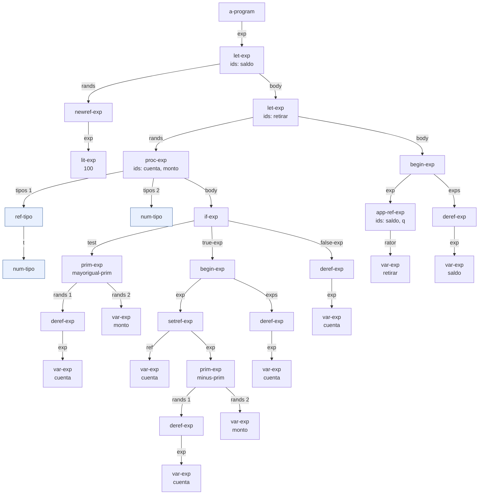
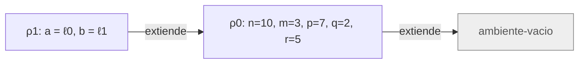
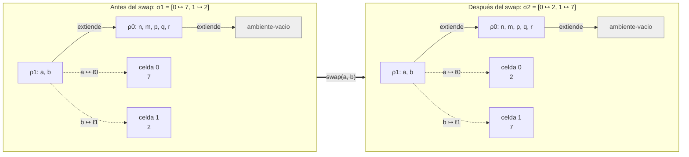

# Informe de AST y traza con almacén — Taller 3: Memoria y disciplina

**Curso:** Fundamentos de Interpretación y Compilación de Lenguajes
de Programación — Universidad del Valle, Sede Tuluá.

**Integrantes del grupo:**

| Nombre | Código | Correo institucional |
|--------|--------|----------------------|
| Carlos Humberto Gutierrez Mejia | 2059817-3743 | carlos.humberto.gutierrez@correounivalle.edu.co |
| Juan Eduardo Calderon Jaramillo | 2611001-3743 | juan.eduardo.calderon@correounivalle.edu.co |
| Jesus David Lopez Diaz | 2611029-3743 | jesus.david.lopez@correounivalle.edu.co |

---

## 1. Gramática considerada

Es la gramática del Taller 2 con las expresiones del almacén y las
anotaciones de tipo. Los constructores son los que genera SLLGEN en
`src/sintaxis.rkt`.

```bnf
<programa>  ::= <expresion>
                a-program(exp)

<expresion> ::= <numero>                          lit-exp(dato)
            ::= <identificador>                   var-exp(id)
            ::= "true" | "false"                  true-exp() | false-exp()
            ::= <primitiva> "(" {<expresion>}*(,) ")"
                                                  prim-exp(prim, rands)
            ::= "if" <expresion> "then" <expresion> "else" <expresion> "end"
                                                  if-exp(test, true-exp, false-exp)
            ::= "let" {<identificador> "=" <expresion>}* "in" <expresion> "end"
                                                  let-exp(ids, rands, body)
            ::= "proc" "(" {<identificador> ":" <tipo>}*(,) ")" <expresion> "end"
                                                  proc-exp(ids, tipos, body)
            ::= "apply" <expresion> "(" {<expresion>}*(,) ")"
                                                  app-exp(rator, rands)
            ::= "applyref" <expresion> "(" {<identificador>}*(,) ")"
                                                  app-ref-exp(rator, ids)
            ::= "newref" "(" <expresion> ")"      newref-exp(exp)
            ::= "deref" "(" <expresion> ")"       deref-exp(exp)
            ::= "setref" "(" <expresion> "," <expresion> ")"
                                                  setref-exp(ref, exp)
            ::= "swap" "(" <expresion> "," <expresion> ")"
                                                  swap-exp(ref1, ref2)
            ::= "begin" <expresion> {";" <expresion>}* "end"
                                                  begin-exp(exp, exps)

<tipo>      ::= "num"                             num-tipo()
            ::= "bool"                            bool-tipo()
            ::= "refto" "(" <tipo> ")"            ref-tipo(t)
            ::= "(" {<tipo>}*(*) "->" <tipo> ")"  proc-tipo(args, res)
```

Se omiten `letrec-exp` y `case-exp` porque los programas de este informe no
los usan; están definidos en `src/sintaxis.rkt`.

---

## 2. Ejemplos de AST

### Ejemplo 1 — Retiro de una cuenta con paso por referencia (enunciado 4.1)

**Expresión concreta:**

```text
let saldo = newref(100)
in
  let retirar = proc (cuenta : refto(num), monto : num)
                  if >=(deref(cuenta), monto)
                  then begin
                         setref(cuenta, -(deref(cuenta), monto));
                         deref(cuenta)
                       end
                  else deref(cuenta)
                  end
                end
  in
    begin
      applyref retirar (saldo, q);
      deref(saldo)
    end
  end
end
```

**AST.** Los nodos de tipo (`ref-tipo`, `num-tipo`) cuelgan del campo `tipos`
de `proc-exp`. Las aristas indican el campo del constructor padre del que
sale cada hijo.



**Explicación.** Hay dos `let-exp` anidados: el exterior liga `saldo` a una
`newref-exp` y el interior liga `retirar` a un `proc-exp`. El `proc-exp` guarda
sus dos anotaciones en el campo `tipos`: `refto(num)` para `cuenta` y `num` para
`monto`. El cuerpo es un `if-exp` cuya rama `then` es un `begin-exp` con un
`setref-exp` seguido de un `deref-exp`. El cuerpo del `let` interior es un
`begin-exp` que aplica `retirar` con `app-ref-exp` y después lee `saldo`. La
primitiva `-` aparece como `prim-exp` con `minus-prim`, no como nodo propio.

**Por qué el programa no pasa el chequeador.** La regla de `applyref` exige que
cada argumento sea un identificador cuyo tipo coincida con el parámetro formal
y además sea una referencia:

$$
\frac{\Gamma \vdash f : (t_1 * \cdots * t_n \to t) \qquad \Gamma(x_i) = t_i \qquad t_i = \mathtt{refto}(s_i)}
{\Gamma \vdash \mathtt{applyref}\ f\,(x_1, \ldots, x_n) : t}
$$

Aquí $f = \mathtt{retirar}$ tiene tipo $(\mathtt{refto}(\mathtt{num}) * \mathtt{num} \to \mathtt{num})$.
El primer argumento cumple: $\Gamma(\mathtt{saldo}) = \mathtt{refto}(\mathtt{num})$.
El segundo no: $q$ viene del ambiente inicial con tipo $\mathtt{num}$, y además el
parámetro formal `monto` está declarado como $\mathtt{num}$. Ese tipo coincide con
el de $q$, pero no es $\mathtt{refto}(s_2)$, así que falla la tercera premisa. El
chequeador lo reporta con:

```text
El argumento 2 de applyref debe ser una referencia, se encontro num
```

En tiempo de ejecución fallaría igual: `applyref` busca `q` en el ambiente,
encuentra el número 2 y levanta error porque no es una referencia.

**Corrección mínima.** Hay que arreglar los dos lados del segundo argumento:
declarar `monto` como `refto(num)`, leerlo con `deref(monto)` en el cuerpo, y
pasar una referencia en lugar del número, creada con `newref(q)` justo antes
de la aplicación:

```text
let saldo = newref(100)
in
  let retirar = proc (cuenta : refto(num), monto : refto(num))
                  if >=(deref(cuenta), deref(monto))
                  then begin
                         setref(cuenta, -(deref(cuenta), deref(monto)));
                         deref(cuenta)
                       end
                  else deref(cuenta)
                  end
                end
  in
    let tope = newref(q)
    in
      begin
        applyref retirar (saldo, tope);
        deref(saldo)
      end
    end
  end
end
```

Ahora $\mathtt{retirar} : (\mathtt{refto}(\mathtt{num}) * \mathtt{refto}(\mathtt{num}) \to \mathtt{num})$,
$\Gamma(\mathtt{saldo}) = \Gamma(\mathtt{tope}) = \mathtt{refto}(\mathtt{num})$, y el programa tiene tipo
$\mathtt{num}$. Al ejecutarlo, $100 \geq 2$, `retirar` escribe $100 - 2$ en la
celda de `saldo` y el resultado es $98$.

Cambiar `applyref` por `apply` también haría pasar el chequeador, pero no es una
corrección equivalente: `apply` copia la celda de `saldo`, el retiro se haría
sobre la copia y el programa devolvería $100$.

---

## 3. Traza de evaluación

**Expresión a evaluar** (segundo ejemplo guía de la Parte 1):

```text
let a = newref(7)
    b = newref(2)
in
  begin
    swap(a, b);
    +(deref(a), *(10, deref(b)))
  end
end
```

**Ambientes.** $\rho_0$ es el ambiente inicial y $\rho_1$ lo extiende con `a` y
`b`. Los valores de `a` y `b` son referencias $\ell_0 = \mathtt{a\text{-}ref}(0)$ y
$\ell_1 = \mathtt{a\text{-}ref}(1)$:

- $\rho_0 = [\,n = 10,\ m = 3,\ p = 7,\ q = 2,\ r = 5\,]$
- $\rho_1 = [\,a = \ell_0,\ b = \ell_1\,]\,\rho_0$

El almacén empieza vacío: $\sigma_0 = [\,]$. Las dos celdas se reservan al
evaluar los operandos del `let`, que se hace en $\rho_0$ y de izquierda a derecha.

**Pasos de la traza.**

| Expresión evaluada | Ambiente | Estado del almacén | Valor resultante |
|---|---|---|---|
| `let a = newref(7) b = newref(2) in ... end` | $\rho_0$ | $\sigma_0 = [\,]$ | (se evalúan los operandos y luego el cuerpo) |
| `newref(7)` | $\rho_0$ | $\sigma_0 = [\,] \;\to\; [\,0 \mapsto 7\,]$ | $\ell_0$ |
| `newref(2)` | $\rho_0$ | $[\,0 \mapsto 7\,] \;\to\; \sigma_1 = [\,0 \mapsto 7,\ 1 \mapsto 2\,]$ | $\ell_1$ |
| `begin swap(a, b); +(...) end` | $\rho_1$ | $\sigma_1$ | $72$ (valor del último) |
| `swap(a, b)` | $\rho_1$ | $\sigma_1 \;\to\; \sigma_2 = [\,0 \mapsto 2,\ 1 \mapsto 7\,]$ | $2$ (contenido anterior de $\ell_1$) |
| `a`, `b` | $\rho_1$ | $\sigma_1$ | $\ell_0$, $\ell_1$ |
| `+(deref(a), *(10, deref(b)))` | $\rho_1$ | $\sigma_2$ | $72$ |
| `deref(a)` | $\rho_1$ | $\sigma_2$ | $2$ |
| `*(10, deref(b))` | $\rho_1$ | $\sigma_2$ | $70$ |
| `deref(b)` | $\rho_1$ | $\sigma_2$ | $7$ |

El `swap` intercambia el contenido de las celdas, no las referencias: `a` sigue
apuntando a $\ell_0$ y `b` a $\ell_1$, pero ahora $\sigma_2(\ell_0) = 2$ y
$\sigma_2(\ell_1) = 7$. Por eso el resultado es $2 + 10 \cdot 7 = 72$.

**Diagrama de la cadena de ambientes** (las flechas van del ambiente que
extiende hacia el ambiente extendido, y la cadena termina en el ambiente vacío):



---

## 4. Estado del almacén antes y después del swap

Dos instantáneas del almacén alrededor de `swap(a, b)`. En ambas, `a` y `b`
apuntan a las mismas celdas; lo que cambia es el contenido. Cada instantánea
incluye la cadena de ambientes completa, con el ambiente vacío al final.



**Explicación.** El `swap` lee los dos contenidos ($7$ y $2$) antes de escribir y
después escribe cada uno en la celda contraria, así que no se pierde ningún
valor. Las referencias $\ell_0$ y $\ell_1$ no cambian, solo lo que hay dentro de
las celdas; esa es la diferencia con intercambiar los nombres. El almacén tiene
dos celdas antes y dos después: `swap` no reserva ni libera celdas.

---

## 5. Referencias

- Friedman, D. P., & Wand, M. *Essentials of Programming Languages*,
  3.ª ed., MIT Press, 2008. Capítulo 2 (ambientes), capítulo 4 (estado
  explícito, paso por referencia) y capítulo 7 (chequeo de tipos).
- Pierce, B. C. *Types and Programming Languages*, MIT Press, 2002.
  Capítulos 8 y 13.